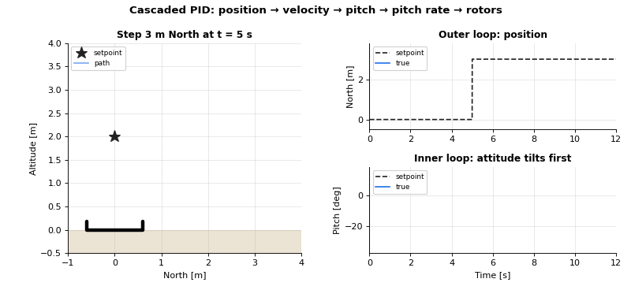

<div align="center">

# Drone GNC Beginner's Guide

**Guidance, Navigation and Control for drones, from first principles to PX4 source code.**

Short Python programs, readable from top to bottom, using the same frames, names and
algorithms as the [PX4 autopilot](https://github.com/PX4/PX4-Autopilot).

[](https://github.com/khanhnger77/Drone-GNC-Beginner-s-Guide/actions/workflows/tests.yml)


</div>

## Why this repository

Each lesson of the companion video course has three layers:

| Layer | What you get |
|---|---|
| **1. Theory** | The equations and the block diagram |
| **2. Minimal Python** (this repo) | The algorithm alone, no framework, every loop visible in `main()` |
| **3. PX4** | Where the same idea lives in PX4, a variable mapping, and a SITL run or ulog to compare with |

The goal is understanding, not performance. When you have read a lesson here, the matching PX4 module
should look familiar.

## Lessons

### 1. Cascaded PID control (2D)



The position setpoint jumps 3 m North. The inner loop tilts the vehicle **before** it moves, the
outer loop then brings it to the target: position → velocity → pitch → pitch rate → rotor thrusts.

- Run: [`simulations/planar/planar_hover_step_response.py`](simulations/planar/planar_hover_step_response.py)
- PX4: `mc_pos_control`, `mc_att_control`, `mc_rate_control`

### 2. Waypoint guidance (2D)


A waypoint follower switches to the next target as soon as the vehicle is inside the acceptance radius.

- Run: [`simulations/planar/planar_waypoint_following.py`](simulations/planar/planar_waypoint_following.py)
- PX4: `navigator` (mission), `NAV_ACC_RAD`

### 3. EKF in the loop: IMU + GPS + baro (2D)


A 2D miniature of EKF2. The IMU drives the prediction, GPS and baro correct it one scalar at a time
with a test-ratio gate, and the unknown gyro bias is estimated. The controller now flies on the
**estimate**: the truth is only used for the plots.

- Run: [`simulations/planar/planar_ekf_imu_gps_baro.py`](simulations/planar/planar_ekf_imu_gps_baro.py)
- PX4: `ekf2`

### 4. 6DOF quadrotor with the PX4 control cascade (3D)

The GIF at the top of this page. A quadrotor X with the PX4 motor order flies a 3D mission:
thrust vector → attitude (`bodyzToAttitude`) → quaternion attitude control → rate PID → control allocation.
The yaw setpoint is rate limited (`MPC_YAWRAUTO_MAX`, 60°/s) and the allocation gives up yaw before the
rotors saturate. Remove both and the same mission tilts the drone to 114°: it flips. Either one alone
keeps the tilt below 43°.

- Run: [`simulations/quadrotor/quadrotor_waypoint_following.py`](simulations/quadrotor/quadrotor_waypoint_following.py)
- PX4: `mc_pos_control/PositionControl/ControlMath.cpp`, `mc_att_control/AttitudeControl`, `control_allocator`, `lib/control_allocation/.../ControlAllocationSequentialDesaturation.cpp`

### 5. Attitude complementary filter (3D)


Integrating the gyro alone drifts with its bias. The complementary filter corrects roll and pitch with
the accelerometer and yaw with the magnetometer, and learns the gyro bias, but only while the
vehicle rotates slowly, as PX4 does.

- Run: [`simulations/quadrotor/quadrotor_attitude_complementary_filter.py`](simulations/quadrotor/quadrotor_attitude_complementary_filter.py)
- PX4: `attitude_estimator_q`

## Quick start

```bash
python3 -m venv .venv
source .venv/bin/activate
pip install -e ".[test]"

python simulations/quadrotor/quadrotor_waypoint_following.py
./run_tests.sh

./tools/fetch_px4.sh   # optional: PX4 v1.17.0 source in external/, to read next to the lessons
```

Use a virtual environment. If matplotlib is installed twice (system and user), the 3D plot fails
with "Unable to import Axes3D".

The GIFs above are rendered from the simulations themselves:

```bash
python doc/make_readme_media.py
```

## Conventions (same as PX4)

| | |
|---|---|
| World frame | **NED** (x North, y East, z Down). Altitude = -z |
| Body frame | **FRD** (x Forward, y Right, z Down). Thrust points to -z |
| Attitude | Quaternion `[w, x, y, z]` rotating body → NED. Euler angles in ZYX order (yaw, pitch, roll) |
| Rotor order | Quadrotor X as in PX4: 1 front right CCW, 2 rear left CCW, 3 front left CW, 4 rear right CW |
| Units | In the names: `_m`, `_mps`, `_mps2`, `_rad`, `_rps`, `_n`, `_nm`, `_s` |
| 2D lessons | The North-Down plane of NED, so every 2D equation is a slice of the 3D one |

## Architecture

The simulator owns the truth. The navigation stack sees only sensor measurements. Each simulation's
`main()` shows the whole loop in a few lines:

```python
imu_sample = imu.measure(vehicle)            # 1. sense (from the true vehicle)
ekf.predict(imu_sample, dt_s)                # 2. estimate
target_m = guidance.update(position)         # 3. guide
rotor_thrusts_n = controller.update(...)     # 4. control
vehicle.step(rotor_thrusts_n, dt_s)          # 5. move the true vehicle
```

```
src/dronegnc/
  common/         rotation.py: quaternion, DCM, Euler, NED/FRD helpers
  vehicle/        planar_quadrotor.py (2D), quadrotor.py (3D 6DOF)
  sensors/        IMU, GPS, barometer, magnetometer with noise, bias and their own rates
  estimation/     planar_ekf.py, attitude_complementary_filter.py
  control/        pid.py, cascade controllers, control_allocation.py
  guidance/       waypoint_follower.py
  simulation/     history.py (a tiny flight log)
  visualization/  2D and 3D animations
simulations/      one script per lesson (planar/, quadrotor/)
tests/            one test per simulation, checking results (errors, final position)
doc/              course roadmap, README media
```

Drawing happens after the run, from the recorded `History`. Simulations therefore run fast, and tests
run without opening windows (`show_plot = False`).

## Roadmap

The full course plan is in [doc/COURSE_ROADMAP.md](doc/COURSE_ROADMAP.md), with the PX4 counterpart of
every lesson: the step-by-step path from a textbook EKF to EKF2, multi-rate control loops, motor
dynamics, jerk-limited trajectories, flight modes and failsafes, and PX4 SITL in Gazebo to fly the same
missions on the real autopilot.

Where the code is heading (a PX4-shaped flight stack with swappable stages, multi-rate loops and a
bridge to real ulogs) is described in [doc/ARCHITECTURE.md](doc/ARCHITECTURE.md).

## Acknowledgements

Inspired by [AutonomousVehicleControlBeginnersGuide](https://github.com/ShisatoYano/AutonomousVehicleControlBeginnersGuide).

## License

MIT. See [LICENSE](LICENSE).
