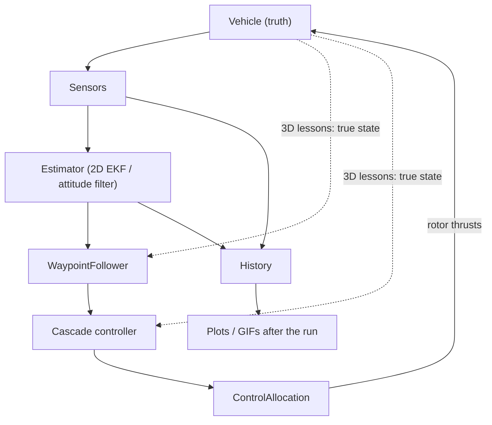
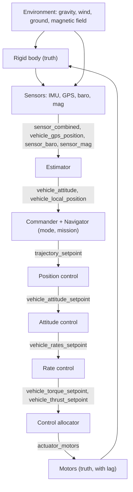
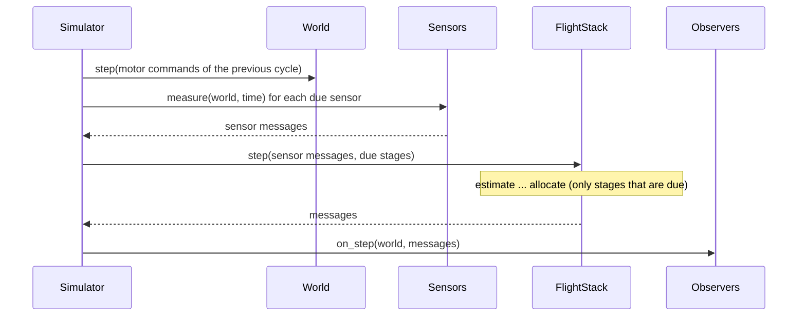
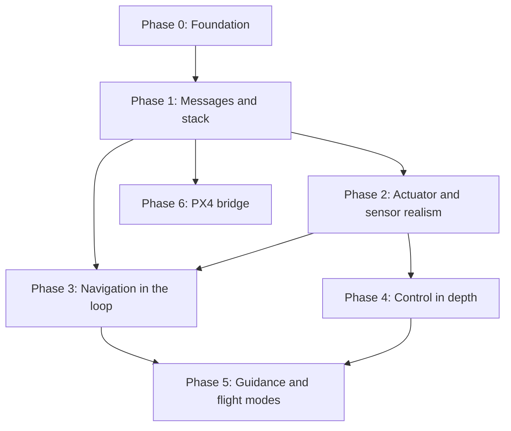

# Architecture and Roadmap

Status: **Proposal** (open for discussion)

This document describes the architecture this project is moving toward and the order in which we plan
to get there. It is for contributors, and for anyone who wants to understand how the simulations fit
together and how they map to PX4. The lesson-by-lesson plan lives in
[COURSE_ROADMAP.md](COURSE_ROADMAP.md). This document covers the code structure that carries those lessons.

## Goal

Learners should be able to study **the whole flight stack of a multicopter** in simulation: sensing,
estimation, guidance, control, allocation and flight modes working together. And they should be able
to **open the matching PX4 module and recognize the same structure**.

They should be able to **swap algorithms and change parameters** at any stage and **compare the
results** on the same scenario. Examples: complementary filter → EKF → error-state EKF, PID → LQR → MPC,
waypoint steps → jerk-limited trajectory, ideal motors → motors with lag.

Today the project covers a 2D and a 3D quadrotor, a PX4-style control cascade with control allocation,
waypoint guidance, a 2D EKF in the loop and a 3D attitude complementary filter. Each lesson is its own
hand-wired simulation. Next, we want 3D estimation in the loop, multi-rate loops, actuator and sensor
realism (motor lag, vibration, latency), trajectory generation, flight modes and failsafes, and a direct
bridge to real PX4 data (ulog, SITL).

## Design principles

1. **Readable first.** This is learning material. The loop "sense → estimate → guide → control →
   allocate → move" must be readable top to bottom in one short function, with no hidden framework.
2. **Mirror PX4's structure, not its machinery.** Stages, message names and parameters follow PX4,
   so a learner can put this code next to PX4. Scheduling, pub/sub and C++ details are explained in
   lessons but not reproduced.
3. **Small, explicit interfaces.** Each stage has a minimal interface (one `update()` method,
   documented with `typing.Protocol`). Any algorithm that implements it can be plugged in.
4. **Truth and estimate are separate.** The simulator owns the true state. The flight stack only sees
   sensor measurements and its own estimates. (Already true today; it stays a hard rule.)
5. **Simulation, flight stack and visualization are separate.** The simulator advances time, the stack
   decides, observers record. Drawing happens after the run, from the log. (Already true today.)
6. **Units and frames are explicit.** NED world, FRD body, quaternion `[w, x, y, z]` body → NED,
   ZYX Euler. Names carry units (`_m`, `_mps`, `_rad`, `_rps`, `_n`, `_nm`, `_s`).

## Current architecture and its limits

Each simulation's `main()` wires the pieces by hand and runs everything at one rate (`dt_s = 0.005`,
200 Hz). It records a `History` and draws only after the run:



What works well and stays: truth/estimate separation, drawing after the run, an installable package,
tests that check results, and PX4 frames and motor order.

| Limit | Today | Blocks |
|---|---|---|
| No shared message types | Each simulation passes raw values between stages. For example, `MulticopterCascadeController.update()` takes seven positional arguments, and the 2D and 3D controllers have different signatures | Swapping stages, mapping data to PX4 uORB topics and ulog fields |
| One rate for everything | Physics, sensors' timers, estimator and all control loops are stepped together at 200 Hz | Multi-rate lesson, bandwidth separation, delayed fusion |
| 3D flies on the truth | Both 3D lessons control with the true state. The complementary filter runs alongside, not in the loop. The 3D `Gps` and `Barometer` exist but are not used | 3D navigation in the loop |
| Ideal actuators | Rotor thrust is applied instantly, only clipped to `[0, max]` | Motor lag, thrust curve (`THR_MDL_FAC`), realistic saturation |
| Ideal sensor timing | No latency, no vibration, constant gyro bias | Delayed fusion horizon, gyro filtering, bias random walk |
| Step setpoints | Switching waypoints is a position step. In the 3D lesson this saturates rotors at every switch (visible in the README GIF) | Jerk-limited trajectories (`PositionSmoothing`) |
| Estimator interfaces differ | `PlanarEkf.predict()/fuse_gps()/fuse_baro()` vs `AttitudeComplementaryFilter.update(imu, mag, dt)` | Comparing estimators on one scenario |
| No flight modes | A simulation is one mission from start to end | Takeoff, land, RTL, failsafe, land detector |
| No link to real PX4 data | No ulog import. Only source code can be compared (`external/PX4-Autopilot`) | Lesson layer 3 (compare with PX4) |
| Tooling | Rendering README media takes about 5 minutes, because every GIF frame is redrawn | Fast iteration on lesson media |

## Target architecture

The simulator owns the truth (top row). The flight stack works only with measurements and estimates.
Stages exchange **messages named after PX4 uORB topics**, so every arrow below has a PX4 counterpart:



For readability the diagram shows only the main flow. The estimate also reaches position, attitude
and rate control, and the gyro sample reaches rate control directly, as in PX4. Observers (log,
visualizer, metrics) see the world and every message without changing them.

### Components

| Component | Responsibility | Interface (sketch) | PX4 counterpart |
|---|---|---|---|
| `Simulator` | Advances physics at a fixed rate, runs each stage at its own rate, notifies observers | `run(duration_s, observers) -> Log` | SITL / `simulator_sih` |
| `World` | True state: vehicle, motors, environment | `step(motor_commands, dt_s)` | `simulator_sih` |
| `VehicleModel` | Rigid-body motion, swappable (planar, 6DOF, 6DOF + rotor drag) | `step(state, forces, dt_s) -> state` | `simulator_sih` |
| `MotorModel` | Command → thrust, swappable (ideal, first-order lag, thrust curve) | `step(command, dt_s) -> thrust_n` | `THR_MDL_FAC`, ESC / motor |
| `Sensor` | Measurement from the truth, with noise, bias, rate, latency, vibration | `measure(world, time_s) -> message or None` | `sensors`, drivers |
| `Estimator` | Attitude, position and velocity from sensor messages | `update(sensors, dt_s) -> (VehicleAttitude, VehicleLocalPosition)` | `ekf2`, `attitude_estimator_q` |
| `Commander` | Flight mode state machine, arming, failsafe, land detection | `update(estimate, time_s) -> Mode` | `commander`, `land_detector` |
| `Navigator` | Setpoints for the current mode: mission, takeoff, land, RTL, trajectory smoothing | `update(mode, estimate, dt_s) -> TrajectorySetpoint` | `navigator`, `flight_mode_manager`, `PositionSmoothing` |
| `PositionControl` | Trajectory setpoint → thrust vector → attitude setpoint | `update(setpoint, estimate, dt_s) -> VehicleAttitudeSetpoint` | `mc_pos_control` |
| `AttitudeControl` | Attitude setpoint → body rate setpoint | `update(setpoint, attitude) -> VehicleRatesSetpoint` | `mc_att_control` |
| `RateControl` | Rate setpoint → torque and thrust setpoint | `update(setpoint, gyro, dt_s) -> (Torque, Thrust)` | `mc_rate_control` |
| `ControlAllocator` | Torque + thrust → motor commands, with desaturation | `allocate(torque, thrust) -> ActuatorMotors` | `control_allocator` |
| `Log`, `Visualizer`, `Metrics` | Observe every message; record, draw after the run, score | `on_step(world, messages)` | `logger` (ulog), Flight Review |

### Key decisions

- **Messages are plain dataclasses named after uORB topics**: `SensorCombined`, `VehicleAttitude`,
  `VehicleLocalPosition`, `TrajectorySetpoint`, `VehicleAttitudeSetpoint`, `VehicleRatesSetpoint`,
  `VehicleTorqueSetpoint`, `VehicleThrustSetpoint`, `ActuatorMotors`. Only fields that a lesson uses
  are included. Field names keep the repo's unit suffixes (`x_m` for PX4's `x`). Each lesson has a
  small mapping table to the PX4 field names.
- **No pub/sub framework.** `FlightStack.step()` is one short function that calls the stages in order
  and passes messages explicitly. Learners read this one function to see the whole flight stack, and
  each stage can be replaced with one line. uORB and work queues are taught in a lesson, but not
  imitated in code.
- **Multi-rate by explicit rates.** Each stage declares `rate_hz`. The simulator runs physics at the
  highest rate and calls a stage only when it is due, reusing `SampleTimer` from the sensors. Between
  calls, a stage's last output message is held, as on the real autopilot. Rates follow PX4 `v1.17.0`, where each
  loop runs when its input topic is published: rate control at gyro rate (`IMU_GYRO_RATEMAX` = 400 Hz),
  attitude control at `vehicle_attitude` rate (`IMU_INTEG_RATE` = 200 Hz), position control at each
  EKF update (`EKF2_PREDICT_US` = 10 ms, so 100 Hz).
- **The log uses the message names.** `Log` stores every message per step, so
  `log["vehicle_local_position"]["x_m"]` reads like a ulog topic. The same plotting code can then draw
  a Python run and a real PX4 ulog side by side.
- **Stages are optional, and single-lesson demos stay.** A lesson about one algorithm uses only the
  stages it needs. Today's five simulations keep working unchanged as lessons. The 2D lessons stay
  standalone introductions and are not ported to the stack: they are slices of the 3D equations, not a
  second stack.
- **One cycle** runs as follows. The simulator, not the animation, advances time:



  The world moves with the motor commands from the previous cycle, the due sensors measure the new
  truth, the due stages update their messages from estimation to allocation, and the observers record
  them. This repeats at the physics rate.

- **Truth vs estimate in drawings:** the vehicle is drawn at its true pose. Estimates are drawn on top
  (estimated path, ±3σ bands).

### How a learner uses it

```python
world = scenarios.square_mission(wind_ned_mps=[2.0, 0.0, 0.0])

stack = FlightStack(
    estimator=Ekf(...),                         # try AttitudeComplementaryFilter + GPS pass-through
    navigator=MissionNavigator(...),            # try JerkLimitedMissionNavigator
    position_control=PositionControl(...),      # try LqrPositionControl
    attitude_control=AttitudeControl(...),
    rate_control=RateControl(...),
    allocator=ControlAllocator(...),
)

log = Simulator(world, stack, physics_rate_hz=1000).run(duration_s=40.0)
plot_tracking(log)
```

A comparison runner runs the same scenario with different stacks without drawing. It reports metrics:
position tracking RMSE, estimation RMSE and NEES (is the filter's covariance honest?), maximum tilt,
time with saturated motors, and mission time.

### Decision: the PX4 bridge

Lesson layer 3 needs real PX4 data. A small `px4/` subpackage reads ulog files (with `pyulog`) into
the same `Log` format. Real sensor data can then be replayed through a Python estimator, and Python
and PX4 outputs plotted with one function. PX4 SITL in Gazebo then gives a full PX4 flying a
realistic model: the same scenario runs in Python and in Gazebo, and both logs go through the same
plots. Offboard control (ROS 2 / uXRCE-DDS) lets the repo's guidance drive PX4 in Gazebo. Gazebo and ROS 2
stay outside the Python package: lessons document how to run them, the package only reads their logs. The core package keeps `numpy` and `matplotlib` as its only dependencies.

All PX4 links are pinned to **`v1.17.0`**. `tools/fetch_px4.sh` clones that tag into
`external/PX4-Autopilot` (git-ignored), so contributors can check every reference against the source.

## Roadmap

Each phase keeps existing simulations and tests working. Phases 2 and 6 only need the interfaces from
Phase 1, so they can run in parallel with the others. Phase 7 continues alongside all phases.



| Phase | Content | Enables |
|---|---|---|
| **0. Foundation** (in progress) | README with GIFs (done). PX4 pinned to `v1.17.0` and roadmap paths checked against it (done). CI on Python 3.9-3.13 and a robust `run_tests.sh` (done). Learning path from README to lessons | Fast feedback, trustworthy PX4 links |
| **1. Messages and stack** | uORB-named message dataclasses. Stage interfaces as `Protocol`. `FlightStack.step()`. `Simulator` with per-stage rates. `Log` keyed by topic. Port the 3D cascade and allocation to stages. First end-to-end demo equal to today's 3D waypoint lesson | Swapping stages, multi-rate loops, PX4-shaped logs |
| **2. Actuator and sensor realism** | Motor lag and thrust curve (`THR_MDL_FAC`). Battery voltage drop and compensation. Sensor latency with timestamps. Gyro bias random walk. Vibration on the IMU. Wind and rotor drag | Lessons on saturation, filtering and delays that look like real flight logs |
| **3. Navigation in the loop** | 3D EKF ladder from [COURSE_ROADMAP.md](COURSE_ROADMAP.md) Module 3: quaternion EKF → error-state → EKF2 state layout → SymPy Jacobians → delayed horizon + output predictor → multiple aiding sources. Hover thrust estimator. 3D lessons fly on the estimate | Estimation lessons comparable with `ekf2` |
| **4. Control in depth** | Gyro filtering (low-pass, notch, dynamic notch) and its phase lag. Airmode, rate feed-forward, I-term limits. Tilt limits and horizontal/vertical thrust priority. Tuning by bandwidth separation. System identification and autotune. LQR / MPC as swappable position controllers | Control lessons comparable with `mc_*_control` and `mc_autotune_attitude_control` |
| **5. Guidance and flight modes** | Jerk-limited trajectories (`PositionSmoothing`). Commander state machine: arm, takeoff, mission, land, RTL. Land detector. Failsafes: GPS loss, low battery, geofence. Orbit and precision landing | Full missions with mode changes |
| **6. PX4 bridge** (can start after Phase 1) | ulog loader into `Log`. Replay real sensor data through the Python estimator and compare with `estimator_states`. Side-by-side plots. PX4 SITL in Gazebo Harmonic (`gz_x500`): same mission in Python and Gazebo, parameter experiments, failure injection, ROS 2 offboard ([COURSE_ROADMAP.md](COURSE_ROADMAP.md) Module 6) | Lesson layer 3 with real PX4 and real data |
| **7. Learning experience** (ongoing) | One design note per stage with its PX4 mapping table. Comparison scenarios. Exercises ("swap the estimator and explain the plot") | Learning by recombining |

Later extensions, outside the multicopter core: fixed-wing guidance and energy control (NPFG, TECS),
VTOL transition, and 3D path planning with obstacle avoidance.

### Ongoing contributions

- New single-algorithm lessons are welcome at any time. They follow the conventions in
  [CLAUDE.md](../CLAUDE.md): a module in `src/dronegnc/`, a script in `simulations/`, a test that checks
  a result, and an update of [COURSE_ROADMAP.md](COURSE_ROADMAP.md). They are connected to the stage
  interfaces when the corresponding phase arrives.
- Every PX4 reference must point to the pinned tag and be checked against it.
