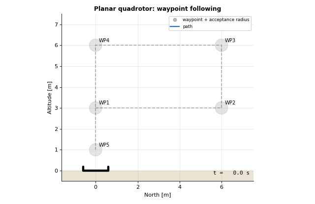

# Lesson 2: Waypoint guidance

Guidance answers "where should I go now?". The simplest answer: the next waypoint, until you are close
enough to it.

- Simulation: [`simulations/planar/planar_waypoint_following.py`](../../simulations/planar/planar_waypoint_following.py)
- Code: [`guidance/waypoint_follower.py`](../../src/dronegnc/guidance/waypoint_follower.py)
- Run: `python simulations/planar/planar_waypoint_following.py`



## 1. Theory

Given waypoints $w_1 \dots w_N$ and the current index $k$:

$$\text{if } \lVert w_k - p \rVert < r_{acc} \text{ and } k < N: \quad k \leftarrow k + 1$$

The current waypoint becomes the **position setpoint** of the cascade from lesson 1. The acceptance
radius $r_{acc}$ trades accuracy for smoothness: a large radius switches early and cuts corners.

For 3D flight, the nose can turn towards the target. The yaw setpoint moves towards
$\operatorname{atan2}(\Delta E, \Delta N)$ at a limited rate (`yaw_towards_target`, used from lesson 4 on).

## 2. The code

```python
target_m = guidance.update([s.x_m, s.z_m])     # waypoint follower
rotor_thrusts_n = controller.update(target_m, s, dt_s)
```

`WaypointFollower` stores only an index. It works in 2D and 3D because it only compares distances.

## 3. What you should see

The vehicle flies the five waypoints of a rectangle and lands on the last one with an error of 1 mm.
The pitch reaches the 35° tilt limit (35.5° at most) after waypoint switches: the setpoint **jumps** by up to 6 m, so the
position loop asks for the maximum speed at once. Lesson 4 shows what this does to the rotors in 3D.

## 4. In PX4 `v1.17.0`

| This repo | PX4 | Note |
|---|---|---|
| `WaypointFollower` | `src/modules/navigator` (mission) | Navigator also handles takeoff, loiter, RTL, land |
| `acceptance_radius_m` | `NAV_ACC_RAD` (default 10 m, set to 2 m for multicopters in `rc.mc_defaults`) | |
| Setpoint = next waypoint | `FlightTaskAuto` and `PositionSmoothing` turn waypoints into a smooth trajectory | PX4 never sends a position step |
| `yaw_towards_target` | `MPC_YAW_MODE` 0 "towards waypoint", rate limited by `MPC_YAWRAUTO_MAX` (60°/s) | |

## 5. Try it

1. Set `acceptance_radius_m=1.5`. How does the path change at the corners? What is the final error?
2. Replace the position step with a ramp: move the setpoint towards the waypoint at 2 m/s. Compare the
   maximum pitch. This is the idea behind PX4's `PositionSmoothing` (a planned lesson).
