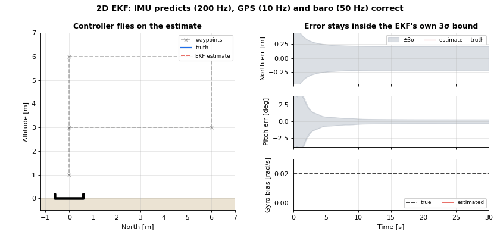

# Lesson 3: EKF in the loop (2D)

Until now the controller read the true state. A real autopilot only has sensors. This lesson builds a
small Extended Kalman Filter with the same structure as PX4 EKF2, and lets the controller fly on its
estimate.

- Simulation: [`simulations/planar/planar_ekf_imu_gps_baro.py`](../../simulations/planar/planar_ekf_imu_gps_baro.py)
- Code: [`estimation/planar_ekf.py`](../../src/dronegnc/estimation/planar_ekf.py),
  [`sensors/planar_sensors.py`](../../src/dronegnc/sensors/planar_sensors.py)
- Run: `python simulations/planar/planar_ekf_imu_gps_baro.py`

## 1. Theory

**State.** $x = [x, z, v_x, v_z, \theta, b_g]$: position, velocity, pitch and the gyro bias.

**Sensors.**

| Sensor | Rate | Measures | Noise |
|---|---|---|---|
| IMU | 200 Hz | gyro $\omega_m = \dot\theta + b_g + n$, accelerometer: specific force $f$ in the body frame | 0.01 rad/s, 0.3 m/s² |
| GPS | 10 Hz | position, velocity | 0.5 m, 0.1 m/s |
| Barometer | 50 Hz | altitude $-z$ | 0.1 m |

**Idea 1: the IMU is the input, not a measurement.** The prediction integrates the IMU:

$$\theta_{k+1} = \theta_k + (\omega_m - b_g)\,\Delta t, \qquad v_{k+1} = v_k + \left(R(\theta) f + g\right)\Delta t, \qquad p_{k+1} = p_k + v_k\,\Delta t$$

Covariance: $P \leftarrow F P F^T + G\,\Sigma_{IMU}\,G^T + Q_{bias}$, where $F = \partial x_{k+1}/\partial x$ and
$G = \partial x_{k+1}/\partial (\omega_m, f)$. The IMU noise enters through $G$, not as a separate guess.

**Idea 2: the bias is a state.** Nothing measures $b_g$ directly. GPS and baro correct position, the
correlations in $P$ carry the correction back to pitch and then to $b_g$.

**Idea 3: sequential scalar fusion with a gate.** Each measurement is one row $H$. For each scalar:

$$\nu = y - h(x), \quad S = H P H^T + R, \quad \text{test ratio} = \frac{\nu^2}{\gamma^2 S}$$

If the test ratio is above 1 (here $\gamma = 5$ sigma) the measurement is rejected. Otherwise
$K = P H^T / S$, $x \leftarrow x + K \nu$, $P \leftarrow P - K H P$. A scalar $S$ needs no matrix inverse.

## 2. The code

| Equation | In `PlanarEkf` |
|---|---|
| Motion model | `predict()`: `self.x = np.array([...])` |
| $F$, $G$, $Q$ | `predict()`: `F[VX, PITCH] = ...`, `G[...]`, `Q = G @ self.IMU_NOISE_VAR @ G.T` |
| GPS: 4 scalars | `fuse_gps()` loops over x, z, vx, vz |
| Baro: altitude $= -z$ | `fuse_baro()`: `H[Z] = -1.0` |
| Test ratio and update | `_fuse_scalar()` |

The loop in `main()`: sense → `ekf.predict()` → `fuse_gps()` / `fuse_baro()` when a sample arrives →
guidance and control on `ekf.estimate()` → move the true vehicle. The truth is only recorded for plots.

## 3. What you should see

The vehicle flies the waypoint rectangle of lesson 2 on the estimate. Measured after the first 5 s:

| | Value |
|---|---|
| RMS error North / Down / pitch | 6.7 cm / 1.8 cm / 0.15° |
| Error inside ±3σ (North, Down, pitch) | 100 % / 100 % / 99.1 % of the time |
| Gyro bias | true 0.020 rad/s, estimate within ±0.002 from t = 3.8 s, final 0.0202 |
| Final distance to the last waypoint (true position) | 9 cm |

"Inside ±3σ" is what makes a filter **consistent**: its own uncertainty is honest. A filter that is
accurate but claims too little uncertainty will reject good measurements later.

## 4. In PX4 `v1.17.0`

| This repo | PX4 EKF2 | Note |
|---|---|---|
| 6 states | `StateSample` in `src/modules/ekf2/EKF/python/ekf_derivation/generated/state.h`: quaternion, vel, pos, gyro bias, accel bias, earth and body mag field, wind, terrain (25 values) | Lessons in Module 3 grow toward this layout |
| Pitch angle | Quaternion, with an **error-state** covariance | Planned lesson |
| IMU as input | `Ekf::predictState()` / `predictCovariance()` (`EKF/covariance.cpp`) | Same idea |
| Hand-written $F$, $G$ | Generated by SymForce from `EKF/python/ekf_derivation/derivation.py` | Planned lesson |
| `gyro_noise_rps` 0.01, `accel_noise_mps2` 0.3 | `EKF2_GYR_NOISE` 0.015, `EKF2_ACC_NOISE` 0.35 | |
| `gyro_bias_random_walk_rps2` 1e-3 | `EKF2_GYR_B_NOISE` 0.001 | Same value |
| GPS position noise 0.5 m | `EKF2_GPS_P_NOISE` 0.5 | Same value |
| GPS velocity noise 0.1 m/s | `EKF2_GPS_V_NOISE` 0.3 | |
| Baro noise 0.1 m | `EKF2_BARO_NOISE` 3.5 | A real baro is much worse than this simulated one |
| Gate 5 sigma | `EKF2_GPS_P_GATE`, `EKF2_BARO_GATE` (5.0) | Same value |
| Test ratio | `test_ratio` in `estimator_aid_src_*` topics (`msg/EstimatorAidSource1d.msg`), computed in `EKF/ekf.h` | Same formula: $\nu^2 / (\gamma^2 S)$ |
| Sequential scalar fusion | `fuseDirectStateMeasurement()` per axis (`EKF/position_fusion.cpp`) | |
| Fusion when the sample arrives | EKF2 fuses on a **delayed** time horizon and predicts forward with an output predictor | Planned lesson |

## 5. Try it

1. Set `innovation_gate_sigma=1.0`. How many measurements does `ekf.num_rejected` count, and what
   happens to the estimate?
2. Set the GPS noise in `fuse_gps()` to 0.05 m while the sensor still has 0.5 m. Is the error still
   inside 3σ?
3. Start the filter with a wrong pitch (`initial_state=PlanarState(pitch_rad=0.3)`). How long until the
   error is inside 3σ?
