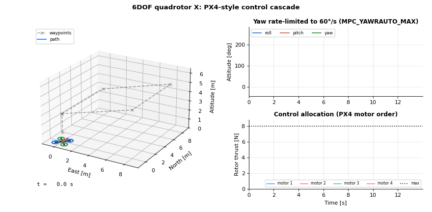

# Lesson 4: 6DOF quadrotor and the PX4 control cascade

The same cascade as lesson 1, now in 3D: attitude becomes a quaternion, and four rotors must produce
one thrust and three moments. This is the structure of the PX4 multicopter stack, loop for loop.

- Simulation: [`simulations/quadrotor/quadrotor_waypoint_following.py`](../../simulations/quadrotor/quadrotor_waypoint_following.py)
- Code: [`control/multicopter_cascade_controller.py`](../../src/dronegnc/control/multicopter_cascade_controller.py),
  [`control/control_allocation.py`](../../src/dronegnc/control/control_allocation.py),
  [`vehicle/quadrotor.py`](../../src/dronegnc/vehicle/quadrotor.py)
- Run: `python simulations/quadrotor/quadrotor_waypoint_following.py`

## 1. Theory

**Vehicle (6DOF).** Quadrotor X, PX4 motor order: 1 front right CCW, 2 rear left CCW, 3 front left CW,
4 rear right CW.

$$m\,\dot v = R\,[0, 0, -T]^T - k_d\,v + m\,g, \qquad J\,\dot\omega = M - \omega \times J\omega$$

Rotor $i$ at $r_i$ with thrust $T_i$ gives the moment $r_i \times [0,0,-T_i]^T$ plus a yaw reaction
$\pm k_M T_i$ (sign from the spin direction).

**Position → thrust vector.** As in 2D: $v_{sp} = K_p (p_{sp} - p)$, PID to $a_{sp}$, $F = m(a_{sp} - g)$,
tilt limited by shrinking the horizontal part.

**Thrust vector + yaw → attitude** (`bodyzToAttitude`). The body z axis must point along $-F$:

$$z_b = -F/\lVert F \rVert, \quad y_c = [-\sin\psi_{sp}, \cos\psi_{sp}, 0], \quad x_b = \frac{y_c \times z_b}{\lVert y_c \times z_b \rVert}, \quad y_b = z_b \times x_b, \quad R_{sp} = [x_b\; y_b\; z_b]$$

**Quaternion attitude control.** The error rotation from the current to the desired attitude, and a
proportional law on its vector part:

$$q_e = q^{-1} \otimes q_{sp}, \qquad \omega_{sp} = 2\,K_{att} \odot \operatorname{vec}(q_e) \quad (\text{with } q_e \text{ taken so that } w \ge 0)$$

**Rate control.** PID per axis on $\omega_{sp} - \omega$, times the inertia: $M = J\,\dot\omega_{sp}$.

**Control allocation.** The effectiveness matrix $B$ maps rotor thrusts to $[M_x, M_y, M_z, T]$:
column $i$ is $[-r_{y,i},\; r_{x,i},\; \pm k_M,\; 1]$. Allocation is $T_{rotors} = B^{+}\,[M; T]$.

**Yaw gives way first.** Yaw authority comes only from the small reaction moment $k_M$, so a large yaw
demand needs large differences between rotors and saturates them. The allocation first computes roll,
pitch and thrust, then adds as much yaw as still fits in $[0, T_{max}]$.

## 2. The code

| Step | Where |
|---|---|
| Rotor layout, PX4 order | `quad_x_rotors()` in `vehicle/quadrotor.py` |
| Rigid body + rotor forces | `Quadrotor.forces_and_moments()`, `Quadrotor.step()` |
| Steps 1-3: position, velocity, thrust vector | `MulticopterCascadeController.update()` |
| Step 4: `bodyzToAttitude` | `thrust_vector_to_attitude()` |
| Step 5: quaternion error | `q_error = quat_multiply(quat_conjugate(quaternion), quaternion_sp)` |
| Step 6: rate PID | `self.rate_pid.update(...)` |
| Allocation and yaw desaturation | `ControlAllocation.allocate()`: `yaw_scale` |
| Yaw setpoint rate limit | `yaw_towards_target(..., np.radians(60.0), dt_s)` in the simulation |

## 3. What you should see

The drone flies a 3D square at 3-5 m altitude, turns its nose towards each waypoint and descends to 1 m at the end.

| | Value |
|---|---|
| Last waypoint reached (within 0.2 m, for good) | t = 12.2 s |
| Maximum tilt | 35.5° (tilt limit 35°) |
| Steps with at least one rotor at its limit | 2.2 % |

**An experiment worth showing in the video.** Run the same mission with the yaw rate limit raised to
1000°/s and the allocation replaced by `np.clip(pinv(B) @ [M, T], 0, T_max)`:

| Yaw rate limit | Yaw gives way first | Maximum tilt |
|---|---|---|
| 60°/s | yes | 35.5° |
| 1000°/s | yes | 42.4° |
| 60°/s | no | 35.8° |
| 1000°/s | no | **113.6°: the drone flips** |

Either protection alone is enough here; PX4 has both.

## 4. In PX4 `v1.17.0`

| This repo | PX4 | Note |
|---|---|---|
| `quad_x_rotors()` | `ROMFS/px4fmu_common/init.d/airframes/4001_quad_x`: `CA_ROTOR0_PX = 1, PY = 1`, ... | Same order and spin. `CA_ROTORn_KM` > 0 means CCW |
| `moment_coef_m` | `CA_ROTORn_KM` (±0.05 in that airframe) | |
| `QuadrotorParams` | `simulator_sih` / Gazebo `x500` model | Lesson in Module 6 |
| Steps 1-3 | `src/modules/mc_pos_control/PositionControl/PositionControl.cpp` | |
| `thrust_vector_to_attitude` | `ControlMath::bodyzToAttitude()` in `PositionControl/ControlMath.cpp` | Same construction |
| Quaternion error | `AttitudeControl::update()`: `qe = q.inversed() * qd`, `eq = 2.f * qe.canonical().imag()`, `rate_setpoint = eq.emult(_proportional_gain)` | Same law. PX4 also reduces yaw with `MC_YAW_WEIGHT` (0.4); omitted here |
| `attitude_gains` | `MC_ROLL_P`, `MC_PITCH_P`, `MC_YAW_P` | |
| Rate PID | `src/lib/rate_control/rate_control.cpp`, `MC_ROLLRATE_P/I/D`, ... | Lesson 1 |
| `ControlAllocation` | `src/modules/control_allocator` + `src/lib/control_allocation/control_allocation/` | |
| Yaw gives way first | `ControlAllocationSequentialDesaturation.cpp`: mix without yaw, then `mixYaw()` | Same priority |
| Yaw rate limit 60°/s | `MPC_YAWRAUTO_MAX` (default 60°/s) | |
| Loop rates: all at 200 Hz | rate ~400 Hz (`IMU_GYRO_RATEMAX`), attitude ~200 Hz (`IMU_INTEG_RATE`), position ~100 Hz (`EKF2_PREDICT_US`) | Multi-rate is a planned lesson |

## 5. Try it

1. Reproduce the table in section 3. Where in the flight does the flip happen?
2. Set `max_tilt_rad=np.radians(45)` (the PX4 default). How do the mission time and rotor saturation change?
3. Swap two rotors in `quad_x_rotors()` without changing the allocation. What does the drone do in the
   first second, and why is checking the motor order the first step of every real build?
