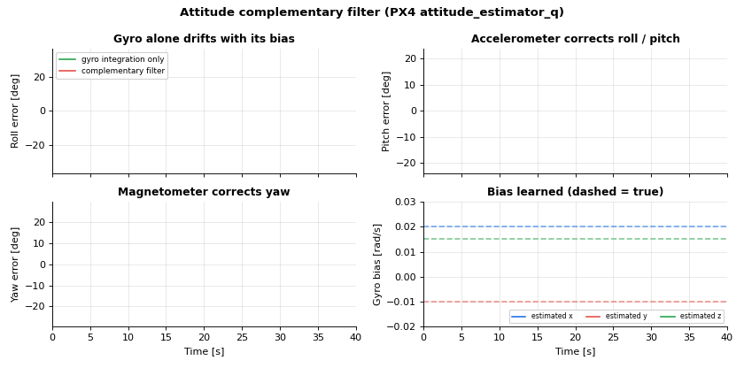

# Lesson 5: Attitude complementary filter

The gyro is fast and smooth, but integrating it drifts with its bias. The accelerometer and the
magnetometer do not drift, but are noisy and disturbed. A complementary filter takes the best of both.
PX4 ships one: `attitude_estimator_q`.

- Simulation: [`simulations/quadrotor/quadrotor_attitude_complementary_filter.py`](../../simulations/quadrotor/quadrotor_attitude_complementary_filter.py)
- Code: [`estimation/attitude_complementary_filter.py`](../../src/dronegnc/estimation/attitude_complementary_filter.py),
  [`sensors/quadrotor_sensors.py`](../../src/dronegnc/sensors/quadrotor_sensors.py)
- Run: `python simulations/quadrotor/quadrotor_attitude_complementary_filter.py`

## 1. Theory

Integrate the corrected gyro (lesson 0), and add a correction rate $c$ built from the other sensors:

$$q \leftarrow q \otimes \Delta q\big((\omega_m - \hat b + c)\,\Delta t\big)$$

**Roll and pitch from the accelerometer.** In steady flight the accelerometer measures $-g$ in the body
frame, so $-f/\lVert f \rVert$ is the measured "down". The predicted down is $R^T [0,0,1]^T$. The cross
product of the two is the rotation that aligns them:

$$c_{acc} = k_{acc}\,\left(d_{measured} \times d_{predicted}\right)$$

**Yaw from the magnetometer.** Rotate the field into NED, take its horizontal heading, compare with the
declination, and correct **only about the NED z axis**, so a disturbed magnetometer cannot tilt the
attitude:

$$e_\psi = \operatorname{wrap}\left(\operatorname{atan2}(m_E, m_N) - \delta\right), \qquad c_{mag} = k_{mag}\, R^T [0, 0, -e_\psi]^T$$

**Gyro bias** is the integral of the correction: $\hat b \leftarrow \hat b - k_b\, c\,\Delta t$, clamped. It is
learned only while the vehicle rotates slowly, because fast rotations make the corrections less reliable.

**The assumption** "the accelerometer measures only gravity" is wrong while accelerating. That is the
main limit of this filter, and the reason EKF2 estimates velocity and attitude together.

## 2. The code

| Equation | In `AttitudeComplementaryFilter.update()` |
|---|---|
| Hold the last mag sample (mag 50 Hz, IMU 200 Hz) | `self.last_mag_body` |
| Initial attitude from accel + mag | `_initial_attitude()` |
| $c_{mag}$ | `yaw_error_rad = ...`, `correction_rps += R.T @ [0, 0, -yaw_error_rad] * self.mag_weight` |
| $c_{acc}$ | `np.cross(down_measured_body, down_predicted_body) * self.accel_weight` |
| Bias, only when rotating slowly | `if np.linalg.norm(imu.gyro_rps) < self.max_spin_rate_for_bias_rps` |
| Propagation | `quat_from_rotation_vector((angular_velocity + correction) * dt_s)` |

The simulation flies the 3D mission of lesson 4 on the truth, and runs the filter and a pure gyro
integration side by side.

## 3. What you should see

The gyro bias is $[0.020, -0.010, 0.015]$ rad/s. After 40 s:

| | Roll | Pitch | Yaw |
|---|---|---|---|
| Error, gyro integration only | 32.0° | 20.9° | 25.8° |
| Error, complementary filter | 0.13° | 0.12° | 1.68° |
| Largest filter error during the flight | 6.1° | 4.3° | 8.5° |

Estimated bias at the end: $[0.0207, -0.0104, 0.0176]$ rad/s. It converges slowly (within 0.003 rad/s
from 19 s to 38.5 s depending on the axis), because it is learned only during the calm parts of the flight.

## 4. In PX4 `v1.17.0`

| This repo | `src/modules/attitude_estimator_q/attitude_estimator_q_main.cpp` | Note |
|---|---|---|
| `accel_weight` 0.2 | `ATT_W_ACC` 0.2 | Same default |
| `mag_weight` 0.1 | `ATT_W_MAG` 0.1 | Same default |
| `gyro_bias_weight` 0.1 | `ATT_W_GYRO_BIAS` 0.1 | Same default |
| `max_gyro_bias_rps` 0.05 | `ATT_BIAS_MAX` 0.05 | Same default |
| `max_spin_rate_for_bias_rps` 0.175 | `if (spinRate < 0.175f)` | Same threshold, `spinRate = _gyro.length()` |
| Mag yaw correction | `mag_earth = _q.rotateVector(_mag)`, `mag_err = wrap_pi(atan2f(mag_earth(1), mag_earth(0)) - _mag_decl)`, `corr += _q.rotateVectorInverse(Vector3f(0, 0, -mag_err)) * ATT_W_MAG` | Same, line for line. PX4 also raises the gain when rotating faster than 50°/s |
| `mag_declination_rad` | `ATT_MAG_DECL`, or automatic from GPS (`ATT_MAG_DECL_A`) | |
| Accel assumed = gravity | `ATT_ACC_COMP`: subtracts the acceleration derived from GPS velocity | Not modeled here |
| Not started by default | `rcS` starts `attitude_estimator_q` only if `ATT_EN` = 1 (default 0); `ekf2` runs by default (`EKF2_EN` = 1) | `attitude_estimator_q` remains a clean reference |

## 5. Try it

1. Set `accel_weight=2.0`. The error during accelerations grows: why?
2. Add a constant 0.1 gauss disturbance to the mag sample along body x. Does the roll error change?
   (It should not: the mag only corrects yaw.)
3. Raise `max_spin_rate_for_bias_rps` to 10 rad/s. Is the bias learned faster or worse?
