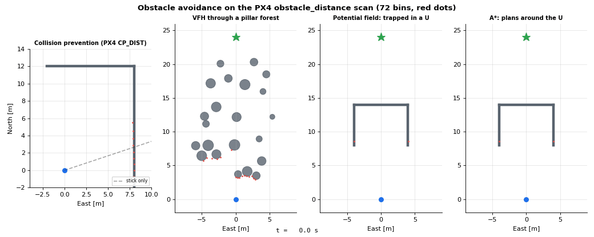

# Lesson 6: Collision prevention

The first obstacle lesson is the one PX4 actually ships. It does not plan a path: it only makes sure the
pilot cannot fly into something. Understanding what it does **not** do motivates the next three lessons.

- Simulation: [`simulations/avoidance/collision_prevention.py`](../../simulations/avoidance/collision_prevention.py)
- Code: [`guidance/collision_prevention.py`](../../src/dronegnc/guidance/collision_prevention.py),
  [`sensors/obstacle_distance_sensor.py`](../../src/dronegnc/sensors/obstacle_distance_sensor.py),
  [`simulation/obstacles.py`](../../src/dronegnc/simulation/obstacles.py)
- Run: `python simulations/avoidance/collision_prevention.py`

## 1. Theory

**The sensor data.** PX4 describes obstacles around the vehicle as the uORB topic `obstacle_distance`:
72 bins of 5°, bin $i$ centered at $i \cdot 5°$ from North (in the local NED frame), each holding the
closest distance seen in that direction. All four obstacle lessons use exactly this layout.

**The braking limit.** To stop with deceleration $a$ before reaching the safety distance $d_{min}$
(`CP_DIST`), after a reaction delay $t_d$ (`CP_DELAY`), the speed towards an obstacle at distance $d$
must satisfy

$$v \le v_{max}(d) = \sqrt{2\,a\,\max\!\left(0,\; d - d_{min} - v\,t_d\right)}$$

**Normal and tangential parts.** Split the requested velocity $v_{sp}$ along the direction $n$ of the
closest obstacle:

$$v_n = (v_{sp} \cdot n)\,n, \qquad v_t = v_{sp} - v_n$$

Limit $\lVert v_n \rVert$ by $v_{max}(d_{closest})$ (only if moving towards it). Limit $\lVert v_t \rVert$ by
$v_{max}$ of the distance measured **in the direction of $v_t$**. The first rule brakes in front of a wall;
the second lets the vehicle slide along the wall and stops it in a corner.

## 2. The code

| Step | Where |
|---|---|
| World of pillars and walls, ray casting | `simulation/obstacles.py`: `CircleObstacle`, `WallObstacle`, `ObstacleMap.ray_distance_m()` |
| 72-bin scan at 10 Hz, 3 rays per bin, min per bin | `ObstacleDistanceSensor.measure()` |
| $v_{max}(d)$ | `CollisionPrevention.max_speed_towards_mps()` |
| Normal / tangential split | `CollisionPrevention.modify_setpoint()` |
| Distance in a direction | `CollisionPrevention.distance_in_direction_m()` |
| Velocity setpoint into the cascade | `controller.update([nan, nan, -altitude], ..., velocity_ff_ned_mps=...)` |

The last line uses the PX4 convention for `trajectory_setpoint`: a NaN position axis means "velocity
control on this axis". The controller adds the velocity feed-forward to the position loop output.

## 3. What you should see

The pilot holds a stick command of 3 m/s East and 1 m/s North for 15 s, towards a wall 8 m East, with a
second wall closing the corridor 12 m North. `CP_DIST` = 1.5 m.

| | Value |
|---|---|
| Smallest distance to any wall | 1.62 m (never below `CP_DIST`) |
| Final position | 10.3 m North, 5.9 m East: stopped in the corner |
| Final speed | < 0.1 m/s |

The distance settles near 2 m, not 1.5 m: `CP_DELAY` = 0.4 s adds a margin proportional to the speed.
The setpoint plot shows small jumps when the closest bin changes from one 5° bin to the next.

## 4. In PX4 `v1.17.0`

| This repo | `src/lib/collision_prevention/CollisionPrevention.cpp` | Note |
|---|---|---|
| `ObstacleDistance` (meters, `inf` = nothing) | `msg/ObstacleDistance.msg`: `uint16[72] distances` in cm, `max_distance + 1` = nothing, `UINT16_MAX` = unknown | |
| `min_distance_m` 1.5 | `CP_DIST` (default −1: **disabled**) | Must be set on purpose |
| `delay_s` 0.4 | `CP_DELAY` (default 0.4 s) | Same default |
| `max_decel_mps2` 3.0 | `MPC_ACC_HOR` (default 3 m/s²) | Same default |
| $\sqrt{2ad}$ | `math::trajectory::computeMaxSpeedFromDistance(MPC_JERK_MAX, MPC_ACC_HOR, ...)` | PX4 also limits jerk |
| Normal / tangential split | `_constrainAccelerationSetpoint()`, with `_getScale()` | PX4 works on the **acceleration** setpoint of `StickAccelerationXY` |
| `distance_in_direction_m` | `_getObstacleDistance()` | |
| No data: do not move | `CP_GO_NO_DATA` (default 0) | |
| Only in Position mode | Used by `FlightTaskManualPosition` / `StickAccelerationXY` | Missions and offboard are **not** protected |
| (not modeled) | `CP_GUIDE_ANG`: bends the setpoint up to 30° towards free bins to pass narrow gaps | |

The last two rows are the key message: collision prevention brakes and slides, but never decides to go
around. In a mission, PX4 flies straight into the wall. Going around is a planner's job (lessons 7-9).

## 5. Try it

1. Set `delay_s=0.0`. How close does the drone get now?
2. Point the stick straight at the wall (`[0, 3]`). Does it slide? Why not?
3. Replace the U-shaped wall of lesson 8 and push the stick North into it. Where does the drone stop?
